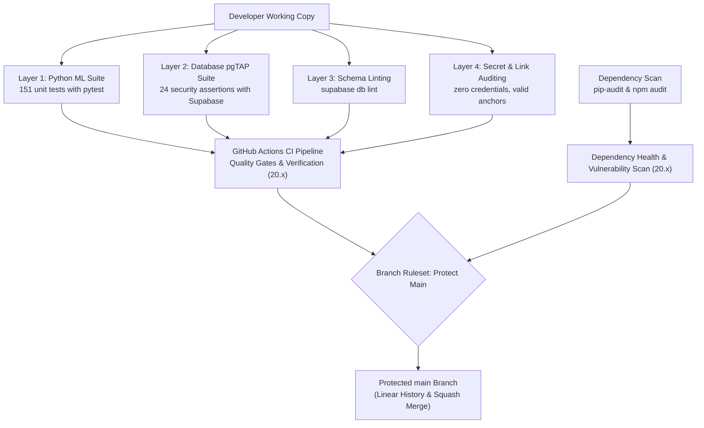

# Testing and Quality Gates

Welcome to the comprehensive quality assurance guide for **SafaiOS**. To maintain production reliability across real-world urban municipal deployments, SafaiOS enforces strict multi-tier quality gates. Every pull request and contribution is automatically tested across computer vision, API contracts, PostgreSQL database migrations, row level security policies, and cryptographic audit ledgers.

This guide provides step-by-step instructions for running tests locally, understanding CI/CD verification pipelines, and debugging test failures before submitting a pull request.

---

## Testing Architecture Overview

SafaiOS employs a multi-layer verification strategy designed to prevent data leakage, model regressions, and security escalations:



---

## 1. Python ML and Core Test Suite (151 Tests)

The Python test suite validates computer vision inference, YOLO11s tensor manipulations, box transformations, dataset stratification, inference profiling, and data augmentation pipelines.

### Running Pytest Locally

Ensure your virtual environment is active:

```bash
# Windows (PowerShell)
.\.venv\Scripts\Activate.ps1

# Linux / macOS
source .venv/bin/activate
```

Run the complete test suite:

```bash
pytest tests/ -v
```

Expected output:
```text
============================= test session starts =============================
platform win32 / linux -- Python 3.11.x, pytest-9.1.1, pluggy-1.6.0
collected 151 items

tests/test_api_schemas.py .........................                      [ 16%]
tests/test_dataset_augmentation.py ..........                            [ 23%]
tests/test_dataset_pipeline.py ................                          [ 33%]
tests/test_dataset_statistics.py ........                                [ 39%]
tests/test_dataset_validator.py ............                             [ 47%]
tests/test_detection_boxes.py ...................                        [ 59%]
tests/test_detection_matcher.py .............                            [ 68%]
tests/test_detection_stratification.py .........                         [ 74%]
tests/test_device.py .....                                               [ 77%]
tests/test_environment.py ......                                         [ 81%]
tests/test_exporter.py .........                                         [ 87%]
tests/test_inference_engine.py ..........                                [ 94%]
tests/test_inference_postprocess.py .....                                [ 97%]
tests/test_logger.py ..                                                  [ 98%]
tests/test_profiler.py ..                                                [100%]

============================= 151 passed in 4.82s =============================
```

### Test Scope Breakdown

| Test Module | Coverage Scope | Critical Invariants |
| :--- | :--- | :--- |
