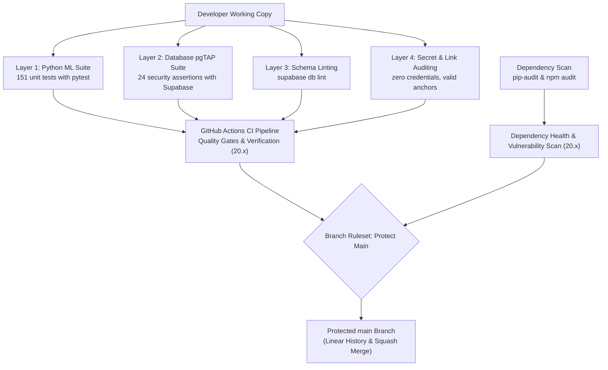

# Testing and Quality Gates

Welcome to the comprehensive quality assurance guide for **SafaiOS**. To maintain production reliability across real-world urban municipal deployments, SafaiOS enforces strict multi-tier quality gates. Every pull request and contribution is automatically tested across computer vision, API contracts, PostgreSQL database migrations, row level security policies, and cryptographic audit ledgers.

This guide provides step-by-step instructions for running tests locally, understanding CI/CD verification pipelines, and debugging test failures before submitting a pull request.

---

## Testing Architecture Overview

SafaiOS employs a multi-layer verification strategy designed to prevent data leakage, model regressions, and security escalations:



---

## 1. Python ML and Core Test Suite (151 Tests)

The Python test suite validates computer vision inference, YOLO11s tensor manipulations, box transformations, dataset stratification, inference profiling, and data augmentation pipelines.

### Running Pytest Locally

Ensure your virtual environment is active:

```bash
# Windows (PowerShell)
.\.venv\Scripts\Activate.ps1

# Linux / macOS
source .venv/bin/activate
```

Run the complete test suite:

```bash
pytest tests/ -v
```

Expected output:
```text
============================= test session starts =============================
platform win32 / linux -- Python 3.11.x, pytest-9.1.1, pluggy-1.6.0
collected 151 items

tests/test_api_schemas.py .........................                      [ 16%]
tests/test_dataset_augmentation.py ..........                            [ 23%]
tests/test_dataset_pipeline.py ................                          [ 33%]
tests/test_dataset_statistics.py ........                                [ 39%]
tests/test_dataset_validator.py ............                             [ 47%]
tests/test_detection_boxes.py ...................                        [ 59%]
tests/test_detection_matcher.py .............                            [ 68%]
tests/test_detection_stratification.py .........                         [ 74%]
tests/test_device.py .....                                               [ 77%]
tests/test_environment.py ......                                         [ 81%]
tests/test_exporter.py .........                                         [ 87%]
tests/test_inference_engine.py ..........                                [ 94%]
tests/test_inference_postprocess.py .....                                [ 97%]
tests/test_logger.py ..                                                  [ 98%]
tests/test_profiler.py ..                                                [100%]

============================= 151 passed in 4.82s =============================
```

### Test Scope Breakdown

| Test Module | Coverage Scope | Critical Invariants |
| :--- | :--- | :--- |
| `test_api_schemas.py` | Pydantic v2 schemas for detections, incidents, and telemetry | Validates coordinate bounding box constraints and status enums |
| `test_dataset_augmentation.py` | Photometric and geometric augmentations (CoarseDropout) | Verifies box label consistency during synthetic occlusions |
| `test_dataset_pipeline.py` | Image normalization, batch tensor transformations | Checks 768px letterbox padding and tensor dtype float32 |
| `test_dataset_statistics.py` | Distribution analyzers across 5 waste classes | Prevents division-by-zero on sparse class bins |
| `test_dataset_validator.py` | Roboflow and YOLO annotation format validator | Rejects out-of-bounds coordinates and malformed labels |
| `test_detection_boxes.py` | Format conversions (xyxy, xywh, normalized, absolute) | Mathematical precision and non-negative width/height bounds |
| `test_detection_matcher.py` | Ground-truth vs prediction IoU matching | IoU threshold matching and confusion matrix calculation |
| `test_detection_stratification.py` | Stratified evaluation across scale and overlap bins | Verifies precision and recall across micro, small, medium, large bins |
| `test_device.py` | Hardware device resolution (CUDA, MPS, CPU) | Safe CPU fallback without crashing when GPU is unavailable |
| `test_environment.py` | Dependency checks, library versions, torch runtime | Confirms PyTorch, torchvision, and ultralytics compatibility |
| `test_exporter.py` | ONNX and TensorRT engine export pipelines | Verifies export flags, dynamic axes, and output validity |
| `test_inference_engine.py` | YOLO11s forward pass, batching, inference lifecycle | Rejects malformed tensors, enforces warm-up passes |
| `test_inference_postprocess.py` | NMS (Non-Maximum Suppression) and confidence thresholds | Drops low-confidence noise, resolves overlapping bounding boxes |
| `test_profiler.py` | Latency and throughput benchmarks | Records percentile latencies (p50, p95, p99) and memory usage |

---

## 2. Supabase Database and Security Suite (24 pgTAP Tests)

SafaiOS relies on PostgreSQL 17 with Row Level Security (RLS) to enforce citizen isolation, driver authorization, and audit immutability. The database test suite is written in **pgTAP** (`supabase/tests/database_foundation.test_test.sql`).

### Running Database Tests Locally

Start local Supabase containers and run the test suite:

```bash
# 1. Start local Supabase (requires Docker running)
supabase start

# 2. Reset database and apply all migrations
supabase db reset

# 3. Execute pgTAP test suite
supabase test db
```

Expected output:
```text
Testing database_foundation.test_test.sql ...
ok 1 - Core tables must exist
ok 2 - Enums must exist
ok 3 - RLS enabled on profiles
ok 4 - RLS enabled on incidents
ok 5 - RLS enabled on assignments
ok 6 - RLS enabled on verifications
ok 7 - RLS enabled on safai_coins_ledger
ok 8 - RLS enabled on audit_logs
ok 9 - Citizen A cannot read Citizen B private incident
ok 10 - Citizen A can read public incident
ok 11 - Driver cannot see unrelated assignments
ok 12 - Driver can see assigned assignments
ok 13 - Driver cannot self-approve cleanup verification
ok 14 - Citizen reporter can approve valid cleanup
ok 15 - Unauthorized user cannot insert verification decision
ok 16 - Viewer cannot insert or update incidents
ok 17 - Admin cannot elevate privileges to Superadmin
ok 18 - Direct balance updates on profiles are blocked
ok 19 - Safai Coins ledger is insert-only (no updates)
ok 20 - Safai Coins ledger is insert-only (no deletes)
ok 21 - Duplicate reward idempotency key is rejected
ok 22 - Incident storage bucket policies enforce isolation
ok 23 - Assignment evidence storage bucket enforces driver scope
ok 24 - Audit logs cannot be updated or deleted by normal roles
1..24
All 24 tests passed!
```

### Security Scenarios Tested

1. **Citizen Isolation**: A citizen authenticated with User ID `A` can query only their own reported incidents or public incidents. Attempting to query another citizen's private unverified report yields 0 rows.
2. **Driver Isolation**: Drivers can view only assignments explicitly dispatched to their driver profile ID.
3. **Anti Self-Approval Constraint**: A driver assigned to clean an incident cannot insert a verification record approving their own cleanup. Such attempts trigger an RLS rejection or database trigger exception.
4. **Append-Only Financial Ledger**: The `safai_coins_ledger` table strictly forbids `UPDATE` and `DELETE` statements. Any balance alteration must be an `INSERT` referencing an authorized event.
5. **Idempotency Protection**: Replaying the same `idempotency_key` for a reward or transaction fails with a unique constraint violation (`23505`).
6. **Immutable Audit Trail**: The `audit_logs` table disallows any client modifications or deletions, preserving administrative accountability.

---

## 3. Database Schema Linting

Supabase CLI includes an automated linter based on `splinter` that scans database migrations for common pitfalls:
- Missing primary keys.
- Unindexed foreign keys.
- Permissive RLS policies (e.g. `USING (true)` on write operations).
- Insecure `SECURITY DEFINER` functions with missing `search_path`.

Run the database linter locally:

```bash
supabase db lint --level error --fail-on error
```

If no errors are found, the command exits with return code `0`.

---

## 4. Secret Scanning and Link Checking

SafaiOS enforces pre-merge automated security scans to guarantee that no API keys, private tokens, or broken documentation links enter the repository.

### Running Secret Scan Locally

```bash
node scripts/secret-scan.mjs
```

This script scans all staged and tracked repository files for patterns matching:
- Supabase Service Role keys.
- Hugging Face / Roboflow API tokens.
- AWS / GCP cloud credentials.
- Private SSH / PGP keys.
- Database connection strings with plaintext passwords.

### Running Documentation Link Check

```bash
node scripts/check-links.mjs
```

This utility verifies all relative markdown links across the `wiki/`, `docs/`, and root documentation files to ensure no dead links or 404 anchors exist.

---

## 5. GitHub Actions Quality Gates and Branch Ruleset

SafaiOS protects the `main` branch with a GitHub Ruleset named **`Protect Main`**. To merge any pull request, two specific status checks must pass:

1. **`Quality Gates & Verification (20.x)`**
   - Runs full Python ML test suite (151 tests) on Ubuntu.
   - Spins up local Supabase CLI, applies all migrations, runs all 24 pgTAP tests, and executes database linting.
   - Executes `node scripts/secret-scan.mjs` and `node scripts/check-links.mjs`.
2. **`Dependency Health & Vulnerability Scan (20.x)`**
   - Scans Python requirements using `pip-audit`.
   - Audits Node packages for high-severity CVEs.
   - Confirms that pinned dependencies have no known vulnerabilities.

### Ruleset Constraints

- **Linear History Required**: Merge commits are blocked. Contributors must squash or rebase commits cleanly.
- **Pull Request Required**: Direct pushes to `main` are disabled. All changes require an approved Pull Request.
- **Dismiss Stale Approvals**: Pushing new commits to an open PR invalidates previous reviews, requiring re-review.
- **Squash Merge**: All PRs are merged via Squash and Merge to keep a clean, atomic Git history.
- **Conversation Resolution**: All open discussion threads on code review must be resolved prior to merge.

---

## 6. Pre-Submission Contributor Checklist

Before pushing your branch and opening a pull request, verify each of the following:

- [ ] Python unit tests pass: `pytest tests/ -v` (151/151 passed).
- [ ] No temporary checkpoints or virtual environments are staged (`git status`).
- [ ] Code formatted according to standard conventions.
- [ ] Secret scan passes: `node scripts/secret-scan.mjs`.
- [ ] Link check passes: `node scripts/check-links.mjs`.
- [ ] Commit history is clean and rebased against latest `upstream/main`.
- [ ] Documentation updated in `wiki/` if functionality changed.

